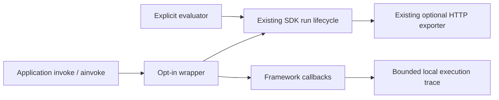

# Experimental automatic execution instrumentation

Observe a LangChain Runnable's runs, tools, model calls and framework steps with one explicit wrapper.
This API is experimental and unreleased. It does **not** decide whether an agent achieved the correct outcome.
Existing SDK 1.3.0 APIs remain unchanged. Do not assume the published 1.3.0 package already includes this feature.

## Install and support

Once a release containing this feature is approved, install `agent-reliability[langchain]`. To try this branch,
build a wheel and install that wheel with the `langchain` extra in an isolated environment.
The extra installs exactly `langchain-core==1.6.13`, the tested callback version. Python 3.11–3.13 are supported.
Core SDK installation still has zero mandatory runtime dependencies. Importing the neutral instrumentation
API does not import LangChain; configuring the adapter requires the extra. An unsupported/missing dependency
raises a fixed setup error before application execution. There is no global framework patch or registration.

Supported: Runnable `.invoke` and `.ainvoke`, public chain/tool/model callbacks, nested wrappers and concurrent
calls. Not supported: wrapper `.stream`/`.astream`/`.batch`, graph/checkpoint-specific interpretation, separate
processes, arbitrary third-party callback ordering or hidden provider retry detection. Keep the original Runnable
for operations outside this surface. The wrapper is not a subclass replacing every Runnable composition API.

## Five-minute offline quickstart

```python
from langchain_core.runnables import RunnableLambda
from langchain_core.tools import tool
from agent_reliability.experimental.instrumentation import instrument
from agent_reliability.sdk import AgentReliability


@tool
def lookup(query: str) -> str:
    """Synthetic offline lookup."""
    return "approved"


agent = RunnableLambda(lambda value: lookup.invoke(value))
observed = instrument(
    agent,
    sdk=AgentReliability(),
    agent_id="support",
    name="Support",
    version="1",
    tool_names=("lookup",),
)
result = observed.invoke("synthetic request")
assert (
    result == "approved"
)  # application output is returned, never retained in the trace
trace = observed.traces[-1]
assert trace.tool_calls == 1
assert trace.complete
observed.disable()  # future calls run without this wrapper's capture
assert observed.invoke("synthetic request") == "approved"
observed.close()  # disable and clear retained traces; idempotent
```

Async callers use `await observed.ainvoke(input, config=...)` while enabled. Normal asyncio task context is
inherited; independent calls have independent SDK run IDs and collectors. A nested enabled wrapper establishes
a child SDK run. Its details belong to that child trace, rather than being counted again in the parent trace.
OS-thread context propagation beyond the framework's public hooks remains the application's responsibility.
The complete runnable offline example, including a fake chat model and explicit evaluation, is
[automatic_instrumentation.py](../examples/automatic_instrumentation.py).

## What is captured

Each immutable `ExecutionTrace` has a SDK run ID, optional parent SDK run ID, ordered immutable event tuple
and bounded diagnostics. Events have random span IDs, captured parent links, UTC observation timestamps,
monotonic elapsed duration and a closed execution state. Framework UUIDs correlate callbacks internally;
raw framework IDs are not copied into arbitrary metadata fields. Sequence reflects observed callback order,
not a total order of independent concurrent operations. Model latency includes callback/framework work and
is not pure provider-network latency.

- Run: start and terminal state through the existing SDK lifecycle.
- Step: framework chain start/end/error hooks; no invented business goals or semantic steps.
- Tool: start/end/error, approved name only, captured parent and duration.
- Model: start/end/error, captured invocation count and optional configured provider/model aliases.
- Usage: documented provider-supplied integer counts only. For one chat generation, `usage_metadata` is used;
  legacy `llm_output.token_usage` is also supported. Ambiguous/malformed/missing totals produce explicit
  `availability="unknown"`, with all counts null. Zero is reported only when the provider reports zero.

`provider_id`/`model_id` are optional configuration assertions about the instrumented workflow, not provider
identity independently verified by this SDK. Leave them unset for mixed-model workflows without a single
accurate safe alias. No model string is extracted from serialized constructor data or response metadata.
No monetary cost is computed; no pricing table or token estimate is inferred from text.

## Execution is not measured reliability

| Observation | What it establishes |
|---|---|
| Agent completed without an exception | Execution completion |
| A tool returned successfully | That tool's execution completed |
| The expected business outcome was evaluated | Only what the explicitly selected evaluator assessed |
| Reliable outcome ratio/SLO | Requires explicit attributable outcomes and existing reliability semantics |

The wrapper never creates `EvaluationRecorded`, PASS or evaluator provenance. Without explicit evaluation,
there is no measured outcome; missing outcomes do not become PASS. UNKNOWN remains UNKNOWN under the existing
reliability API and chosen unknown policy. To connect the captured run to an explicit outcome, use the existing
current run and evaluator APIs *inside* the Runnable's execution:

```python
from agent_reliability.evaluation import (
    EqualityEvaluator,
    EvaluatorIdentity,
    EvaluationExecutionFailure,
)
from agent_reliability.sdk import EvaluatorRunner, current_run


def evaluate_expected_answer(answer):
    evaluator = EqualityEvaluator(
        identity=EvaluatorIdentity("expected-answer", "1"), expected="approved"
    )
    result = EvaluatorRunner().evaluate(evaluator, answer)
    run = current_run()
    if run is not None:  # can be None when this wrapper is disabled or unsampled
        if isinstance(result, EvaluationExecutionFailure):
            run.record_evaluation_failure(failure=result, indicator="task_success")
        else:
            run.record_evaluation(indicator="task_success", result=result)
    return answer
```

Choose an evaluator appropriate to the actual outcome; string equality is only an offline illustration.
Configure an existing HTTP sink and its deployment binding explicitly if remote lifecycle/evaluation delivery
is needed; its [indicator policy, privacy and delivery semantics](HTTP_EXPORTER.md) are unchanged.
**Detailed execution/step/tool/model/token traces stay local in this slice.** No additional HTTP path, P18/P20
producer, platform dashboard claim or unrestricted export is introduced. A separate contract review is required
before adding that transport.



## Privacy and security boundaries

This capture path does not retain prompts, model-response text, tool inputs/results, documents, headers,
credentials, arbitrary metadata, tags, exception messages or customer exception class names. Only explicitly
approved safe tool names can appear; unknown names are omitted. Callback payloads are handled by the framework
itself, which naturally still sees the application data. This guarantee does not change third-party tracing,
customer callbacks or existing custom SDK sinks/diagnostic handlers. Configure LangSmith/other tracers separately;
this adapter neither enables them nor changes their configuration.

Agent/name/version/environment and configured aliases must be1–128 ASCII characters from `[A-Za-z0-9._-]`.
Use non-sensitive logical aliases. Grammar checks cannot determine whether a seemingly valid alias contains a
secret. Tool allowlists are explicit, finite and validated; no dynamic names, hashing of secrets or arbitrary
metadata capture. Application failure is exported with a fixed classification, while the original exception
object is re-raised unchanged to the application. No optional raw-content capture exists.

## Limits and measurement health

`CaptureLimits` defaults:1000 child spans per run, depth16,32 active runs per wrapper and8 retained traces;
hard ceilings are1000/16/128/32. At most512 approved aliases may be configured. Each accepted span reserves
start and terminal space: at most `2 * max_spans + 2` events per trace. Excess starts are dropped with counters,
oldest completed traces are evicted, and excess active invocations pass through without capture. Counters saturate
at2^63−1. Returned snapshots held by customer code are outside the wrapper's memory bound.

Truncation, malformed/conflicting callbacks, unknown parents, callback failures and unfinished captured spans
produce explicit partial diagnostics and monotonically mark the existing SDK run `PARTIAL_EVIDENCE` before its
health is submitted. Missing provider usage is an explicit unknown fact, not automatically a semantic evaluator
failure. Duplicate equivalent callbacks are ignored; conflicting identities cannot manufacture completeness.
Missing ends are closed with synthetic `incomplete` markers and unknown actual duration; cancellation marks
observed cancellation. Abrupt process death cannot guarantee a terminal record or flush.

`sample_rate` defaults to1.0;0 disables capture for all invocations. Intermediate rates use a wrapper-local seeded
pseudo-random sequence, independent of outcomes (seed0; sequence depends on admission order). Unsampled calls
produce no new SDK run from this wrapper and are counted separately. Existing outer instrumentation may still
observe work. Sampling is not a statistical calibration guarantee. Duplicate initialization by wrapping an
already instrumented wrapper is refused. `disable` affects future calls; `close` also discards retention and
prevents in-flight calls from repopulating it. Neither cancels customer work. A closed wrapper cannot be enabled.

Callbacks do no I/O and have bounded collector work, but Python scheduling/lock waits have no hard time bound.
Existing SDK sink behavior is retained; a user-supplied blocking sink is not made non-blocking by this wrapper.
See the local [performance methodology](../benchmarks/instrumentation.py); recorded development results are
not production latency, maximum throughput or negligible-overhead claims.

## Troubleshooting

- Missing/unsupported extra: install the exact supported version in an isolated environment; do not bypass the check.
- Empty trace list: inspect `status.enabled`, sampling, active-run admission and setup-failure counters.
- `complete=False`: inspect fixed diagnostic counters; do not treat partial traces as complete topology.
- Unknown tokens: check whether the provider supplies supported usage fields; do not substitute zero/estimates.
- No outcome reliability: add an explicit appropriate evaluator; execution alone cannot supply a business result.
- SDK run has partial health: remove callback defects or raise configured limits within the hard caps; do not erase health flags.
- No platform step/tool/token view: that producer transport is outside this initial slice; only existing lifecycle/evaluation delivery is available.
