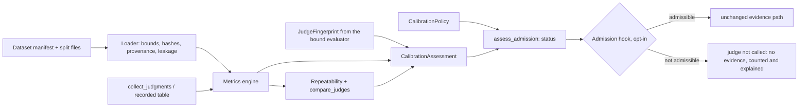

# P29 judge calibration and evaluation trustworthiness: architecture (v2)

Status: **v2.1, revised after the independent architecture review and its re-check** (round 1: 8 HIGH, 10 MEDIUM; re-check: 5 HIGH, 5 MEDIUM, all dispositioned in section 13) (`S4_ARCHITECTURE_REVIEW.md`: 8 HIGH, 10 MEDIUM; every item is dispositioned in
section 13). Implementation starts only after the reviewer re-checks this version. Scope, constraints and existing/missing split:
[GAP_ASSESSMENT.md](GAP_ASSESSMENT.md). Repository: the open-source SDK, stdlib only. The platform is **not** changed.

## 1. Goals and non-goals

Answer, reproducibly and offline: how accurate a judge configuration is against labelled examples, how repeatable, how it disagrees with another
configuration, when a calibration stops applying, and whether its outcomes may feed reliability SLO evidence.

Non-goals: hosted workflows, review UI, dataset collection, provider-backed benchmarking, paid calls, platform changes, changes to `EvaluatorIdentity`,
the P28 wire or measurement health, retraining, provider switching, a CLI, statistical drift tests on live decisions, approval workflows, and any claim
that a calibrated judge is accurate in production.

## 2. Placement and layering

* New Experimental package **`agent_reliability.experimental.calibration`** (stdlib only, no network, no environment reads; the only I/O is reading local
  dataset files whose manifest the caller names, with byte caps). It ships its own small strict-JSON reader and validators and depends on `experimental.judge`
  only through **public names, including the additions listed next**.
* **Additive changes to the guarded judge package (complete list; N-3):** (1) a read-only `behaviour` property on `LLMJudge` and `SyncLLMJudge` returning an
  immutable `JudgeBehaviour` {limits, `repeats`, `min_confidence`, `capture_reason`, `template_digest`}; (2) a public `template_digest(rubric)` function in
  `core.py` that renders the real prompt builder for a fixed probe and returns the sha-256 (the judge exposes neither its limits nor its policy today);
  (3) the calibration-agnostic admission hook in `coordinator.py` (section 8); (4) `wilson_interval` re-exported from the judge `__all__`. Everything else
  (rubrics, schemas, prompt `jp1`, `calibration-case/1`, `calibration-report/1`, fixtures) is byte-identical; the judge compat snapshot gains the new names.
* The existing `run_calibration` / `CalibrationReport` stay as they are. The new package has its **own runner** (`collect_judgments`) that returns the
  per-run judgment table, because `run_calibration` keeps only the first run's decision per case.

## 3. Data model (immutable; artefacts content-free)

**Dataset manifest** `gentlity.reference-dataset/1` (JSON): `dataset_id`, `dataset_version`, `created_at` (aware UTC), `license`, `description`, `rubric`
{`rubric_id`, `rubric_version`, `dimension`}, `label_provenance` (declared; must equal the derived value, below) and `splits`: any of `train`, `calibration`,
`heldout` -> {`file`, `sha256`, `case_count`}. Hard limits checked **before** reading: 8 MiB per split file, 25 MiB per dataset, 20 000 cases per split,
64 KiB per line, nesting depth 8. Split files must lie in the manifest's directory (no `..`, no absolute paths, symlinks refused).

**Case** `gentlity.reference-case/1`: `calibration-case/1` plus optional `adjudication` {`method`: `none` | `majority` | `third_reviewer` | `unresolved`} and
`label_provenance` (`synthetic` | `human_single` | `human_multi` | `human_adjudicated`). It converts to `CalibrationCase`. Label rules enforced at load:
labels list present => labeler ids stable role ids (not personal names); if all labels agree and adjudication is `none`, `human_label` must equal them; if
they disagree, adjudication must be `majority`/`third_reviewer` with `human_label` set, otherwise the case is **`unresolved`** (ground-truth ambiguous, whatever
`human_label` says). `human_single`/`human_multi`/`human_adjudicated` claim at least 1/2/2 labeler entries.

**Derived provenance.** The dataset's provenance is the **weakest** of its cases (order synthetic < human_single < human_multi < human_adjudicated). A declared
value that differs fails the load. The assessment reports counts per provenance, the number of cases with >= 2 labeler entries, and the number adjudicated.
Provenance remains an **attestation by whoever wrote the file**; the code can make it visible and consistent, not true. Every status prints it as `attested`.

**Judgment** (example x fingerprint digest x run index): `outcome` in {PASS, FAIL, UNKNOWN, FAILURE, MISSING}, optional `failure_class` (closed names from
`FAILURE_CLASS_NAMES`), optional declared `confidence_level`. `FAILURE` = the evaluation ran and produced no verdict; `MISSING` = no judgment exists for an
example that should have one. Never merged.

**JudgeFingerprint.** Derived **from the bound evaluator**, not typed in by the caller: `rubric_id`, `rubric_version`, `rubric_fingerprint`, `dimension`,
`template_id`, `template_digest`, `limits_digest`, `capture_reason`, `configuration_id` (existing composed id), plus the **caller-declared**
`ModelDeclaration` {`provider`, `model_id`, `model_version` or null} which is a separate, always-displayed part of the fingerprint and of every decision.
* `template_digest` = sha256 of the prompt rendered by the real builder for a fixed internal probe rubric and fixed nonce, plus the parser/engine constants
  that affect behaviour (output schema id, requested temperature, repair prompt text). A unit test pins it to `tests/fixtures/p29/prompt_golden_jp1.json`, so a
  template edit that forgot to bump `template_id` fails CI. (Fixtures are not shipped in the wheel; the runtime digest does not read them.)
* `limits_digest` covers `JudgeLimits` (input/output bounds, attempts, repair attempts) because they change failure and abstention behaviour.
* `behaviour_digest` = sha256 over the canonical JSON of all of the above **except** `implementation_version` and the model declaration's display fields;
  **equivalence = equal `behaviour_digest` and equal `ModelDeclaration`**. `implementation_version` (SDK version) is recorded and shown in `diff()` but does not
  force re-calibration on a patch release.
* **Stated limitation (H-2).** Provider, model id and version are *declarations*. The judge never observes the model that answered (no model metadata in
  `ProviderReply`), so a **silent provider-side model update is undetectable** by this design except through (i) expiry, (ii) re-calibration, and (iii) the
  existing Session 2 methodology check **only if the caller encodes the model version in `model_label`** (which reaches `configuration_id`). We recommend
  that. An additive `ProviderReply.model_version_observed` would close part of the gap but touches the judge API: owner decision OD-S4-4, not implemented.

## 4. Statistical definitions (normative)

Notation. Ground truth `h` in {pass, fail, unknown}. The **positive class is `fail`**. The **labelled evaluation set** `E` (not "eligible", to avoid the
SLO term) = examples of the evaluated split with `h` in {pass, fail} **and** not `unresolved`. Examples with `h = unknown` or `unresolved` form the
**indeterminate set** `I`. Per example the judge outcome `o` is from **run index 0** of the fingerprint under assessment (fixed, recorded as
`run_index_used`, with `runs_available`); no run selection is possible.

4.1 **Counts** (over `E`; these partition `|E|`): `answered = TP+FN+FP+TN`, `abstained` (UNKNOWN), `failed` (FAILURE), `missing` (MISSING); with
`TP` = (h fail, FAIL), `FN` = (fail, PASS), `FP` = (pass, FAIL), `TN` = (pass, PASS); `support_fail`, `support_pass` = class sizes in `E`;
`fail_abstained`, `fail_failed`, `fail_missing` and the same for `pass`. `judged = answered + abstained`.

4.2 **Rates and denominators** (the rates do **not** partition; each states its denominator):

| Rate | Numerator | Denominator | Meaning |
|---|---|---|---|
| `verdict_rate` | judged | \|E\| | the judge returned PASS/FAIL/UNKNOWN |
| `committed_coverage` | answered | \|E\| | the judge committed to PASS/FAIL (an always-UNKNOWN judge scores 0) |
| `abstention_rate` | abstained | judged | UNKNOWN share of verdicts |
| `failure_rate` | failed | \|E\| | evaluation failure (provider/format/budget/overload) |
| `missing_rate` | missing | \|E\| | no judgment at all |
| `accuracy_conditional` | TP+TN | answered | correct when committing |
| `accuracy_effective` | TP+TN | \|E\| | correct, counting abstention/failure/missing as not correct |
| `fnr_conditional` | FN | TP+FN | defects the judge passed, among defects it committed on (`= 1 - recall_fail`) |
| `fnr_effective` | support_fail - TP | support_fail | defects **not flagged FAIL** (passed, abstained, failed or missing) |
| `fpr_conditional` | FP | FP+TN | false alarms among good runs it committed on |
| `fpr_effective` | FP | support_pass | false alarms over all good runs |
| `precision_fail` / `precision_pass` | TP / TN | TP+FP / TN+FN | descriptive, prevalence-dependent |
| `recall_fail` / `recall_pass` | TP / TN | TP+FN / TN+FP | descriptive |
| `f1_fail` / `f1_pass` | 2TP / 2TN | 2TP+FP+FN / 2TN+FN+FP | descriptive; TP=0 with errors is **0**, not undefined; ignores the other cell; no interval; not a policy input |

Naming rule: suffix `_conditional` = over `answered` of that class; `_effective` = over all `E` examples of the class (`fnr_effective` is the larger, conservative miss rate; `fpr_effective` is *smaller* than `fpr_conditional` because abstentions dilute it, so it is reported for completeness and is not the conservative choice for false alarms). **`fnr_effective` is the SLO-relevant
miss rate**: reliability drops UNKNOWN (`IndicatorCoverage` / SLI), so an abstained defect inflates reliability exactly like a false PASS. It is conservative
under either SLI UNKNOWN policy; a policy using `_conditional` is only valid where abstentions are acceptable and must say so. Precision and accuracy depend on
class prevalence; policies use the prevalence-free FNR/FPR. Metrics are also reported **per difficulty stratum** (`clear`, `ambiguous`, `borderline`,
`adversarial`) and pooled; the pooled headline excludes `borderline` and `adversarial` exactly as the existing report does, and says so.

4.3 **Undefined values.** A ratio with a zero denominator, or a statistic that is not computable, is `Undefined(reason)` with reason in {`zero_denominator`,
`single_class`, `no_judgments`}. JSON: `{"value": null, "undefined_reason": "..."}`; never 0, 1, NaN or an exception. Every proportion carries numerator,
denominator, the **Wilson 95% interval** (existing convention, for display) and the **Clopper-Pearson 95% interval** (exact; used by policy). Neither is
rounded before a policy comparison; reported values are rounded to 6 digits for rendering only. **Independence assumption:** both intervals treat examples as
independent trials; examples from one conversation or source violate it, so datasets should contain one example per source cluster (documented; not
checkable by the library).

4.4 **Indeterminate set `I`** is reported, never mixed into 4.2: `indeterminate_fraction = |I| / (|E|+|I|)`, `commit_rate_on_indeterminate = answered_on_I / |I|`
(informational: human indecision is not truth, so a commit is not automatically an error), `abstention_rate_on_indeterminate`. Excluding `I` flatters accuracy
when much of the hard data is indeterminate; therefore `indeterminate_fraction` is a policy criterion (`max_indeterminate_fraction`).

4.5 **Agreement is not correctness.** Judge-vs-human and judge-vs-judge agreement report raw agreement and Cohen's kappa over the explicit category set
{PASS, FAIL, UNKNOWN} on judged pairs (kappa `Undefined(single_class)` when expected agreement is 1). Comparison reports always include each judge's correctness and
`shared_errors` (both committed, equal, both wrong).

4.6 **Inter-labeler agreement** is deliberately simple: over cases with >= 2 labeler entries, `mean_pairwise_agreement` (mean over cases of the fraction of
agreeing labeler pairs) and the count of such cases; kappa is not computed because it requires a fixed rater pair. A policy may set `min_inter_labeler_agreement`.

4.7 **Repeatability** (examples with >= 2 runs of the **same behaviour digest**): among examples with >= 2 non-FAILURE runs, `unstable` = more than one distinct
outcome in {PASS, FAIL, UNKNOWN}; report `n`, `unstable`, rate with intervals, flip kinds (pass<->fail vs involving UNKNOWN) and `mean_pairwise_agreement`.
`excluded_for_failures` (examples with < 2 usable runs because of failures) is reported, and `unstable_rate_worst_case` counts every excluded example as unstable
(its Clopper-Pearson upper bound is what a policy uses). Record `repetitions` and the caveat that identical requests to a caching or deterministic provider are
trivially stable, so stability is only informative if repetitions are independent calls.

4.8 **Disagreement taxonomy** (`compare_judges(a, b)`; requires different behaviour digests or model declarations, otherwise use repeatability). Each example gets
exactly one category by the ordered rule: `missing` > `evaluation_failure` > `indeterminate_ground_truth` > `judgment_disagreement` (PASS vs FAIL) >
`abstention_mismatch` (one UNKNOWN, one committed) > `both_abstain` > `agreement` (same PASS/FAIL). Counts per category are reported; **no combined
disagreement rate**. Rates with their own denominators: `judgment_disagreement_rate` over examples where both committed and truth is determinate;
`abstention_mismatch_rate` over examples where both returned a verdict and truth is determinate.

4.9 **Confidence.** Only the categorical level the judge declares is summarised (accuracy and counts per level). No probability, Brier score, ECE or
reliability diagram is produced; a test asserts their absence.

## 5. Calibration assessment (`gentlity.calibration-assessment/1`)

Content-free, deterministic JSON (sorted keys, injected aware-UTC clock): `fingerprint` (all components, `behaviour_digest`, model declaration), `dataset`
{id, version, manifest sha-256, split, case_count, provenance counts, derived provenance, `attested`: true}, split discipline findings, all counts/metrics of 4.x,
repeatability, `run_index_used`, `runs_available`, `heldout_attempt` (caller-supplied attempt number on this held-out set, because trying many fingerprints
against one held-out set is uncontrolled multiple testing), `created_at`, and an `integrity` member: a plain sha-256 over the canonical document, plus an
**optional HMAC-SHA256** (`sign(key)` / `verify(key)`, stdlib `hmac`) that is the only forgery-resistant form; an unsigned or unverified assessment is labelled
`integrity: unverified` in every decision. Only the **held-out** split may be assessed (train/calibration tune prompts, rubrics and thresholds and would inflate
every metric); assessing requires `expected_manifest_sha256` from the caller so the held-out data was pinned **before** running. The loader refuses a dataset
with cross-split leakage.

**Leakage** is reported with **counts and `case_id`s only** (no digests, which are dictionary-reversible for short content): duplicate `case_id` within/across
splits; identical canonical content; identical content after NFKC + case-fold + whitespace collapse. Near-duplicate and rubric/few-shot copying from held-out
cases are not detectable (documented).

## 6. Calibration policy and status

`CalibrationPolicy` is a frozen dataclass where **every field is required (no defaults)** (OD-S4-1): `min_examples`, `min_per_class`, `min_adversarial_fail`,
`min_committed_coverage`, `max_abstention_rate`, `max_failure_rate`, `max_missing_rate`, `max_fnr`, `fn_basis` (`conditional`|`effective`), `max_fpr`,
`fp_basis`, `max_adversarial_pass_on_fail` (count, normally 0), `max_unstable_rate`, `min_repeat_cases`, `max_indeterminate_fraction`,
`min_inter_labeler_agreement` (nullable), `accepted_label_provenance` (set), `min_human_fraction`, `min_multi_labeled_fraction`, `validity_days`,
`max_dataset_age_days`, `demonstration_only` (bool). `CalibrationPolicy.starting_point()` is an explicit, caller-invoked preset:
min_examples 400, min_per_class 150, min_adversarial_fail 30, committed coverage >= 0.80, abstention <= 0.20, failure <= 0.02, missing <= 0.02,
`max_fnr` 0.05 (effective), `max_fpr` 0.10 (conditional), adversarial FAIL-case passes = 0, unstable <= 0.05 over >= 150 repeat cases, indeterminate fraction
<= 0.20, inter-labeler agreement >= 0.80, accepted provenance {human_multi, human_adjudicated}, human fraction 1.0, multi-labelled fraction >= 0.5,
validity 90 days, dataset age 365 days. These are the proposals of `P28_P29_CALIBRATION_PREPARATION.md` section 10 made **sample-size-coherent**
(an upper bound of 0.05 needs 72 error-free cases; 150 allows two errors) - they are **adapted from, not identical to,** that document: its inter-labeler kappa became mean pairwise agreement, its `precision(pass)` criterion is not used (prevalence-dependent), its over-confidence criterion is reported as `commit_rate_on_indeterminate` (informational) with an indeterminate-fraction cap, and its repeatability and failure criteria use the exact upper bound. They make no safety claim.
**Coherence check:** construction rejects a policy whose `min_per_class` (or `min_repeat_cases`) cannot satisfy a rate bound even with zero errors (computed
with the exact bound), and rejects non-positive sizes, rates outside (0,1], and aware-UTC violations. Every decision prints the full policy summary and a
`policy_below_starting_point` flag (not a block, so D10 is respected).

**Which examples each criterion measures (N-4).** Rate criteria (`committed_coverage`, `abstention`, `failure`, `missing`, `fnr`, `fpr`, `unstable`) are computed
on the **pooled headline** (`clear` + `ambiguous` difficulty), the same slice the existing report calls headline. `min_adversarial_fail` and
`max_adversarial_pass_on_fail` are computed on the `adversarial` stratum only (a count criterion: the number of defect cases the judge PASSED). The
`borderline` stratum is **reported but not assessed by any criterion** (stated in every assessment as `borderline: reported_only`); it is where people and judge are
expected to disagree. The size minima (`min_examples`, `min_per_class`) apply to the headline slice.

**Construction rules tying synthetic, demonstration and calibrated (N-5).** `synthetic` may appear in `accepted_label_provenance` only if `demonstration_only=True`;
a `demonstration_only` policy can only yield `demonstration` (on any data, including human data), never `calibrated`; `calibrated` requires
`demonstration_only=False`, `accepted_label_provenance` a subset of {human_single, human_multi, human_adjudicated}, and a derived dataset provenance (the weakest
case value, so one synthetic case makes the dataset `synthetic`) inside that set. `min_human_fraction` is therefore removed (it was redundant, N-10).

**Integrity requirement (N-12).** `require_verified_integrity` (bool, required field; `starting_point()` sets it true) makes status depend on a verified HMAC:
an unsigned or unverified assessment can then only be `uncalibrated`. When false, an unverified assessment may be admissible and every decision says
`integrity: unverified`.

**Criterion test (three-way).** For an upper-bound criterion (rate <= limit) using the **Clopper-Pearson** bounds on unrounded counts: `met` if upper <= limit;
`violated` if lower > limit; else `inconclusive`. For a lower-bound criterion (rate >= min): `met` if lower >= min; `violated` if upper < min; else
`inconclusive`. **A criterion whose rate is `Undefined` is `inconclusive` (N-8).** Size/provenance/leakage criteria are `met`/`violated`.

**Status** (first applicable; every criterion verdict is listed in `reasons`):
1. `uncalibrated` - no assessment; integrity digest mismatch; not the held-out split; `created_at` more than 60 s in the future; or any **measured** rate
   criterion is `violated`.
2. `incompatible` - the current fingerprint's `behaviour_digest` or model declaration differs from the assessed one, or the rubric id/version/dimension differs
   from the dataset binding (reasons name the components).
3. `insufficient_reference_evidence` - dataset too small, a class or adversarial stratum below minimum, provenance not accepted or below the human/multi-labelled
   fractions, leakage found, inter-labeler agreement below minimum, indeterminate fraction too high, or **any criterion `inconclusive`** (the data cannot show the
   judge is within the limit). The reasons separate "not provably good" from "measurably bad".
4. `calibration_expired` - everything passes but `now - created_at > validity_days` or the dataset is older than `max_dataset_age_days`.
5. `demonstration` - a `demonstration_only` policy on synthetic data passes; **never admissible**.
6. `calibrated` - all criteria `met`, current, compatible. Meaning: *meets the caller's stated policy on the named held-out dataset for exactly this behaviour
   digest and model declaration at that time.* Not a statement about production accuracy. A vacuous caller policy still yields `calibrated`, which is why the
   policy summary and flag accompany it.

**Evidence admissible = status `calibrated`.** (Naming: "admission", not "eligibility", which collides with the SLO "eligible run".) There is no approval
attestation in this slice (cut: it cannot authenticate; separation of duties is a platform/process control).

## 7. Drift (slice: deterministic and minimal)

`assess_drift(assessment, current_fingerprint, now)` returns three indicators, each `clear` | `indicated` with evidence: `fingerprint_changed` (component-wise
diff), `calibration_expired`, `dataset_stale`. Live decision-mix shift, failure-rate shift and error-rate change are **deferred**: they need a statistical and
product design and cannot be validated offline without data (reviewer scope cut). Drift is advisory; `fingerprint_changed`/`expired` already demote the
status. No retraining, no provider switching, no significance claim anywhere.

## 8. Admission layer, hook and platform

Principles preserved: UNKNOWN is not PASS; missing evidence is not proof; evaluator failure is not agent failure; judge disagreement is not agent failure;
deterministic evaluators and history untouched; `MeasurementHealth` untouched (OD-10).

* **Pure function** `assess_admission(assessment, current_fingerprint, policy, now) -> AdmissionDecision(admissible, status, reasons, policy_summary,
  integrity, assessment_digest)` and `AdmissionDecision.explain()` (content-free text for application dashboards).
* **Generic hook (calibration-agnostic, in `coordinator.py`).** `Admission` is a protocol with two methods: `bound_to(evaluator) -> bool` and `decide(indicator, evaluator) -> AdmissionVerdict` (`allow` or `skip(reason_code)`, a
  bounded closed reason string). **`IndicatorBinding` rejects (ValueError) any admission whose `bound_to(evaluator)` is false** (N-1), so a gate built for judge X
  cannot be attached to judge Y; the hook receives the bound evaluator, not just its identity. `IndicatorBinding(admission=...)` accepts an `Admission`, `None` (today's behaviour) or the
  explicit `UNGATED` sentinel. The calibration package implements it as `CalibrationGate`. New generic disposition `SKIPPED_BY_ADMISSION` and report kind
  `skipped_admission`; **calibration vocabulary never enters the judge enums**. Evaluation order in `_prepare`: admission first, then sampling (so ineligible
  runs sampled out are still counted as admission skips and the magnitude is visible); **the admission status is recomputed with the clock on every call** (N-2), so an expired calibration stops being admissible at the moment it expires; only the
  fingerprint, the integrity verification and constants are cached. The hook runs under the scope lock and must be non-blocking (documented, tested). **A hook
  that raises (Exception) fails closed** (N-13): the call is skipped with reason `admission_error`, counted and reported, and the exception is never propagated into
  the run or logged with content; `BaseException` propagates as elsewhere. A skip makes **no provider call, records no evidence and no failure**, so run health is
  unchanged and `attempted`/reliability exclude it; a new per-indicator `admission_skipped` counter (every call skipped by an admission, any reason) and observer report make it locally visible. Counter semantics
  (N-7): `ungated_model_backed` counts recorded evaluations of model-backed evaluators whose binding has `admission=None`; bindings with the explicit `UNGATED`
  sentinel are counted separately as `explicitly_ungated`; neither affects reliability or health.
* **Gate binds to the running evaluator.** `CalibrationGate.for_evaluator(evaluator, model, assessment, policy, clock, hmac_key=None)` computes the fingerprint **from the bound
  evaluator** at construction (cached; the evaluator is immutable) and `bound_to` re-derives it, so a gate cannot approve evidence from judge Y under judge X's assessment; only the model declaration is
  caller-supplied and it is displayed in every decision.
* **What this does and does not guarantee (H-1).** The brief's requirement - an uncalibrated judge must not silently produce trusted semantic SLO evidence - is
  satisfied **for gated bindings only**. These paths bypass any gate and remain ungated: using `LLMJudge`/`SyncLLMJudge` directly through
  `EvaluatorRunner`, calling `run.record_evaluation` yourself, and any `IndicatorBinding` left at `None`. Mitigations in this slice: (a) `CoverageReport` gains an
  `ungated_model_backed` count so ungated judge evidence is visible locally; (b) the docs and SG checklist state that an ungated judge's outcomes are
  uncalibrated unless the application proves otherwise; (c) **owner decision OD-S4-2:** make an explicit choice (a gate or `UNGATED`) mandatory for model-backed
  evaluators in the next minor release (acceptable on an Experimental API, changelog entry), or keep `None` as the default. This slice keeps `None` and does not
  silently change recording behaviour.
* **Missing-evidence semantics (M-9).** Recording nothing is consistent with the Session 2 guard (`decide_guard`: no determinate evidence -> `no_data` /
  `insufficient_data`, absence never recovers an active alert). Residual hazards, documented: a calibration expiry silently turns a monitored indicator into a
  blind spot that the platform shows only as absence (indistinguishable from no traffic until OD-S4-3); with `on_no_data=warn` the P7 gate is permissive (SG-6 must
  set `block` where needed); run health stays HEALTHY while the semantic evidence is absent, as with unsampled runs; a window straddling a re-calibration can mix
  configuration ids and trip the guard's methodology rule. SG-5 is amended to alert on `admission_skipped`.
* **Platform.** No wire member, API, schema or migration change. `PLATFORM_PROPOSAL.md` outlines (not implements) carrying the status and behaviour digest as
  evaluator-provenance data so the Session 2 guard could exclude inadmissible judge evidence from SLO windows (OD-S4-3). Today the guard sees only rubric id/
  version/configuration id, so a change that alters `configuration_id` already appears as a new methodology; a silent provider update does not.

## 9. Offline demonstration

Synthetic fixtures (`tests/fixtures/p29_calibration/`, provenance `synthetic`, hand-computable confusion matrices; public synthetic data may be in future model
training sets and **must never be used to gauge a real model**) and the scripted fake provider run end to end with no network: load -> leakage -> judgments ->
metrics -> repeatability -> comparison -> fingerprint -> assessment -> policy -> status -> drift -> gate. `examples/judge_calibration_offline.py` prints the
walkthrough. A `demonstration_only` policy shows the machinery; a human-provenance policy shows `insufficient_reference_evidence` on the synthetic set.

## 10. Privacy, security and limits

Artefacts hold identifiers, counts and bounded enums only (no digests of content, no reasons, no raw output); tests plant canaries in case text, rubric text,
failure messages and assert absence in every artefact and `repr`. Dataset files are untrusted: strict JSON (duplicate keys, NaN, Infinity rejected), the byte/line/
count/depth caps of section 3, hash pinning (`expected_manifest_sha256` required to assess), path containment. Prompt injection inside samples is handled by the
existing judge framing; the adversarial stratum is reported separately and a policy criterion bounds adversarial passes on defect cases. Poisoned or LLM-generated
"human" labels are mitigated, not eliminated (visible provenance, adjudication metadata, inter-labeler agreement, min human fraction); a calibration set
contaminated by the judge's own outputs is a documented threat. Integrity: plain digests detect accident only; HMAC detects tampering by anyone without the key.
No CLI exists, so no path prints a status from an unverified file. Provider-backed runs reuse the judge's existing opt-in provider, budgets, timeouts and retry
policy; this slice adds none and makes no provider call in tests. Case ids should be opaque. Using an LLM to judge an LLM inherits shared blind spots, position and
verbosity bias, prompt-wording sensitivity, and non-stationarity of hosted models; calibration measures one configuration on one distribution at one time, with
the held-out set reused on every attempt (`heldout_attempt`).

## 11. Compatibility

Unchanged: `EvaluatorIdentity`, `EvaluationRecorded`, P28 schemas/fixtures, `MeasurementHealth`, rubrics, prompt `jp1`, `calibration-case/1`,
`calibration-report/1`, the judge `__all__` (new names are added to it deliberately and to the compat snapshot: `Admission`, `AdmissionVerdict`, `UNGATED`, `JudgeBehaviour`, `template_digest`, `wilson_interval`, the `behaviour` property,
`EvaluationDisposition.SKIPPED_BY_ADMISSION`, report kind `skipped_admission`, `IndicatorBinding.admission`, `IndicatorCoverage.admission_skipped`, `IndicatorCoverage.ungated_model_backed`, `IndicatorCoverage.explicitly_ungated`). A new snapshot of the `IndicatorBinding` and `EvaluationDisposition` shapes is added in the same change (none existed).
Python 3.11-3.13; zero runtime dependencies.

## 12. Owner decisions

OD-S4-1 policy vs P29-D10 (note: D10's primary record is absent from the repository, `P28_P29_GOVERNANCE_INDEPENDENT_REVIEW.md` F-14); OD-S4-2 default gating
(explicit choice mandatory vs `None` default); OD-S4-3 platform visibility and use of status; OD-S4-4 additive `ProviderReply.model_version_observed`.

## 13. Disposition of the architecture review

H-1 section 8 (honest scope, `ungated_model_backed`, OD-S4-2); H-2 sections 3, 8 (fingerprint from the bound evaluator, declaration limits, OD-S4-4); H-3 4.2 (F1);
H-4/H-5 4.1-4.2 (denominator table, `committed_coverage`, `_effective`, `fnr_effective` SLO-relevant, naming rule); H-6 section 6 (coherent preset, retracted claim,
coherence check, adversarial/ambiguous/failure criteria); H-7 section 6 (three-way test); H-8 section 3 (derived provenance, counts, fractions);
M-1 sections 2, 4 (run 0 fixed, own runner, public names only); M-2 4.6; M-3 4.4, policy; M-4 4.7; M-5 4.3, section 5 (Clopper-Pearson, unrounded, independence,
`heldout_attempt`); M-6 section 3 (runtime digest, limits, behaviour digest); M-7 section 6 (future dates, binding, policy summary, no approval); M-8 section 8
(generic hook, order, counters, snapshots); M-9 section 8; M-10 sections 3, 5, 10; L-1 naming; L-2 4.8; L-3 `PLATFORM_PROPOSAL.md` and the D10 note.
Scope cuts adopted: no CLI, drift reduced to three indicators, no approval attestation, simple inter-labeler agreement.

**Re-check of v2 (N-1..N-14):** N-1 hook receives the evaluator and `IndicatorBinding` enforces `bound_to` (section 8); N-2 status recomputed per call; N-3 section 2 and 11 list
every additive change to the judge package; N-4 per-criterion slices and the explicit `borderline: reported_only` line (section 6); N-5 construction rules and removal of
`min_human_fraction`; N-6 preset wording; N-7 counter semantics; N-8 `Undefined` is `inconclusive`; N-9 GAP_ASSESSMENT corrected; N-10 provenance is the weakest case value
across the loaded splits, `min_human_fraction` removed; N-11 the indeterminate set is named distinctly from the `ambiguous` difficulty stratum; N-12 `require_verified_integrity`;
N-13 fail-closed hook; N-14 breadth acknowledged (`compare_judges` and HMAC are the first cuts if the slice must shrink).
