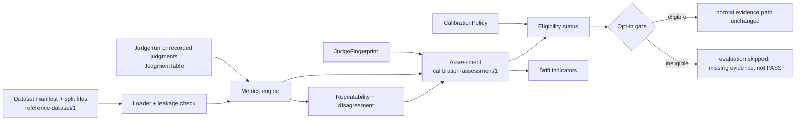

# P29 judge calibration and evaluation trustworthiness: architecture (v1, for review)

Status: **DRAFT for independent architecture review. No code beyond this document has been written.** Scope, constraints and the
existing/missing split are in [GAP_ASSESSMENT.md](GAP_ASSESSMENT.md). Repository: the open-source SDK
(`agent-reliability`), stdlib only. The proprietary platform is **not** changed.

## 1. Goals and non-goals

Answer, reproducibly and offline: how accurate is an LLM judge against human-reviewed labels, how repeatable, how does it disagree with
other judge configurations, when does a calibration stop applying, and may its outcomes feed reliability SLO evidence.

Non-goals: hosted workflows, review UI, dataset collection, provider-backed benchmarking, paid calls, platform changes, changes to
`EvaluatorIdentity`, the P28 wire or measurement health, retraining, provider switching, any claim that a calibrated judge is accurate in
production.

## 2. Placement and layering

New Experimental package **`agent_reliability.experimental.calibration`** (stdlib only, no network, no environment reads, no I/O except
reading local dataset files the caller names). It depends on `experimental.judge` (rubric fingerprint, `TEMPLATE_ID`, `wilson_interval`,
`CalibrationCase`, the strict JSON loader, `_jsonschema.validate`) and on nothing else. The existing judge package, its `__all__`, schemas
and fixtures are unchanged, so its compat snapshot stays byte-identical. Existing `CalibrationReport` (`calibration-report/1`) remains the
way to *run* a judge over cases; the new package analyses **judgments**, which may come from that run or from a recorded file.

## 3. Data model (all immutable, content-free except the dataset files)

**Dataset manifest** `gentlity.reference-dataset/1` (JSON): `dataset_id`, `dataset_version` (opaque, printable), `created_at` (UTC),
`license` (SPDX id or short text), `description`, `rubric` {`rubric_id`, `rubric_version`}, `label_provenance` of the dataset
(`synthetic` | `human_single` | `human_multi` | `human_adjudicated`), `splits`: map `train` | `calibration` | `heldout` to
{`file`, `sha256`, `case_count`}. Limits: at most 3 splits, 100 000 cases per split, 1 MiB per case, files read as bytes and hashed before parsing.

**Case** `gentlity.reference-case/1` = `calibration-case/1` plus optional `adjudication` {`method`: `none` | `majority` | `third_reviewer` | `unresolved`}
and `label_provenance`. `reference-case/1` converts to the existing `CalibrationCase` so the existing harness can run it. Per-labeler
`labels` use role identifiers, not personal data.

**Honesty rule.** `synthetic` data can exercise the machinery and can never satisfy a policy that requires human labels; the report states
the provenance in every artefact. `unresolved` adjudication marks ground-truth ambiguity.

**Judgment** (one row per example x judge fingerprint x run index): `outcome` in {`PASS`, `FAIL`, `UNKNOWN`, `FAILURE`, `MISSING`}, optional
`failure_class` (the existing closed class names), optional declared `confidence_level` (existing categorical level), no text. `FAILURE` means
the evaluation ran and produced no verdict (provider error, timeout, malformed output, budget, overload). `MISSING` means no judgment exists for
an example that should have one. They are different conditions and are never merged.

**JudgeFingerprint** (canonical JSON, sha-256 `digest`): `provider`, `model_id`, `model_version` (nullable, never guessed), `implementation_version`
(SDK version string), `rubric_id`, `rubric_version`, `rubric_fingerprint`, `template_id`, `template_digest` (sha-256 of the golden prompt fixture
bytes for that `template_id`, so a template edit that forgot to change the id is still visible), `configuration_id` (the existing composed id:
min confidence, repeats, citations). All components use the existing identity intersection grammar. Two fingerprints are equivalent **iff the
digests are equal**; display names and `model_label` alone never imply equivalence. A component-wise `diff()` names what changed. Raw prompts are
never captured; only identifiers and digests.

## 4. Statistical definitions (normative)

Notation. Ground truth `h` in {pass, fail, unknown} is the dataset's `human_label` (adjudicated). The **positive class is `fail`** (a defect the
judge should flag). The **eligible** set `E` is the examples with `h` in {pass, fail} in the evaluated split. Examples with `h = unknown` are
ground-truth-ambiguous: they are excluded from accuracy/precision/recall/FPR/FNR and reported separately (section 4.5). Per example the judge
outcome `o` (first run, or the run named by the caller) is one of PASS, FAIL, UNKNOWN, FAILURE, MISSING.

4.1 **Counts.** Over `E`: `judged` = outcomes in {PASS, FAIL, UNKNOWN}; `answered` = outcomes in {PASS, FAIL}; `abstained` = UNKNOWN; `failed` = FAILURE;
`missing` = MISSING. `TP` = (h fail, o FAIL); `FN` = (h fail, o PASS); `FP` = (h pass, o FAIL); `TN` = (h pass, o PASS). `fail_abstained` = (h fail, o UNKNOWN);
`pass_abstained` = (h pass, o UNKNOWN). `support_fail` / `support_pass` = counts of `h` in `E` (all outcomes). Identity: `answered = TP+FN+FP+TN`.

4.2 **Coverage and abstention.** `coverage = judged / |E|` (denominator is every eligible example, including FAILURE and MISSING, so missing
evidence lowers coverage and cannot be hidden). `answer_rate = answered / judged`. `abstention_rate = abstained / judged`. `failure_rate = failed / |E|`.
`missing_rate = missing / |E|`. These four plus `answered` partition `|E|`.

4.3 **Error and quality metrics (conditional on answered unless named otherwise).**
`accuracy = (TP+TN) / answered`; `accuracy_end_to_end = (TP+TN) / judged` (abstention counts as not correct);
`precision_fail = TP/(TP+FP)`; `recall_fail = TP/(TP+FN)`; `precision_pass = TN/(TN+FN)`; `recall_pass = TN/(TN+FP)`;
`f1_class = 2PR/(P+R)`; `fpr = FP/(FP+TN)`; `fnr = FN/(FN+TP)` (note `fnr = 1 - recall_fail`);
abstention-inclusive: `miss_rate_fail = (FN + fail_abstained)/support_fail_judged` and `false_alarm_rate = FP / (pass judged)` where "judged" restricts to
judged examples of that class. Conditional metrics describe the judge **when it commits**; abstention-inclusive metrics describe the judge as a
**filter**. Both are reported; a policy must name which it uses. The library never selects one silently.

4.4 **Undefined values.** Any ratio with a zero denominator, any F1 with undefined or zero-sum P+R, and kappa with expected agreement 1 return
`Undefined(reason)` with `reason` in {`zero_denominator`, `single_class`, `no_judgments`, `insufficient_samples`}; JSON renders
`{"value": null, "undefined_reason": "..."}`. There is no silent 0 or 1, no NaN, no exception. **Intervals:** every proportion reports its numerator,
denominator and the Wilson 95% interval (existing `wilson_interval`); F1 and kappa carry no interval (stated). **Sufficiency** is not decided by the
metric layer; it is a policy criterion (section 6). A dataset smaller than the caller's `min_examples` still reports metrics with their wide intervals,
flagged `below_policy_minimum`.

4.5 **Ground-truth-ambiguous examples** (`h = unknown`, or adjudication `unresolved`): reported as `ambiguous_support`, `ambiguous_decisive_rate`
(judge committed PASS/FAIL where people could not decide: "over-confidence"), and `ambiguous_abstention_rate`. They never enter accuracy.

4.6 **Agreement is not correctness.** Judge-vs-judge and judge-vs-human agreement use raw agreement and Cohen's kappa (existing definition;
kappa undefined at expected agreement 1). Comparison reports always carry both judges' correctness against `h` and a `shared_errors` count (both
decisive, equal, and both wrong), so two judges agreeing is never presented as evidence they are right.

4.7 **Inter-labeler agreement.** Over examples with at least two distinct labeler entries: raw agreement and Cohen's kappa between the first two
labelers (generalisation to more labelers is out of scope and documented), with the count of examples ignored for having a single label. Judge
metrics are flagged `uninterpretable_labels` when inter-labeler kappa is below a policy floor (default none; a caller choice).

4.8 **Repeatability.** For examples with at least two runs of the **same fingerprint digest**: `unstable` if the set of outcomes in {PASS, FAIL, UNKNOWN}
across runs has more than one element; `run_failed` if any run is FAILURE (counted separately and excluded from the stability numerator and
denominator); `pairwise_agreement` = mean over example of (agreeing run pairs / run pairs) on non-failed runs. Reported as counts, `unstable_rate`
with Wilson interval, plus `flip_kinds`: pass<->fail flips vs flips involving UNKNOWN. Runs of different fingerprints are never pooled.

4.9 **Disagreement taxonomy** (`compare_judges(a, b)`). Each example gets exactly one category by the ordered rule: `missing` (either MISSING) >
`evaluation_failure` (either FAILURE) > `ambiguous_ground_truth` (h unknown/unresolved) > `judgment_disagreement` (one PASS, other FAIL) >
`abstention_mismatch` (one UNKNOWN, the other decisive) > `agreement` (same outcome). Counts are reported for every category and **no combined
"disagreement rate" is computed**; `judgment_disagreement_rate = judgment_disagreement / (examples with both decisive and determinate truth)` is
stated with its own denominator. Fingerprints must differ or the run indices must differ; comparing a fingerprint against itself is rejected.

4.10 **Confidence.** Only the categorical level the judge already declares is summarised (accuracy per level, with counts). No probability,
Brier score, ECE or reliability diagram is produced, because categorical judgments do not carry calibrated probabilities; the architecture
states this limitation and a test asserts the absence.

## 5. Calibration assessment (`gentlity.calibration-assessment/1`)

Content-free JSON, deterministic (sorted keys, injected clock, canonical float rendering by rounding to 6 digits as in report/1): `assessment_version`,
`created_at`, `fingerprint` (components + digest), dataset {id, version, manifest sha-256, split, case_count, label_provenance, created_at}, split
discipline result (leakage findings), counts and metrics (4.1-4.5), repeatability, optional inter-labeler agreement, policy (verbatim), status and
reasons (section 6), and an `integrity` digest (sha-256 over the canonical document without that member). An assessment may only be produced from the
**held-out** split; assessing `train` or `calibration` raises (those splits tune prompts/rubrics/thresholds and would inflate every metric).

**Split leakage.** Within and across splits the loader reports: duplicate `case_id`; identical `content_digest` (sha-256 of the canonical role-tagged
parts); and equal `normalized_digest` (NFKC, case-folded, whitespace-collapsed text). Any cross-split finding makes the dataset `leaky`; assessment
refuses a leaky dataset. Near-duplicate detection beyond normalisation is out of scope and documented.

## 6. Calibration policy and status

`CalibrationPolicy` is a frozen dataclass whose **every threshold has no default** (OD-S4-1): `min_examples`, `min_per_class`, `min_coverage`,
`max_abstention_rate`, `max_fnr_upper`, `max_fpr_upper`, `max_unstable_rate_upper`, `min_inter_labeler_kappa` (nullable = not required),
`validity_days`, `max_dataset_age_days`, `accepted_label_provenance` (set; `synthetic` is rejected at construction for any policy not explicitly
flagged `allow_synthetic_for_demonstration=True`, and such a policy can only yield the status `demonstration`, never `calibrated`),
`rate_basis` (`conditional` | `abstention_inclusive`), `require_approval`. All rate criteria compare the **Wilson bound** (upper for error rates,
lower for coverage), not the point estimate. `CalibrationPolicy.starting_point()` returns a documented preset (min_examples 200, min_per_class 50,
coverage lower bound 0.90, abstention <= 0.20, FNR upper <= 0.10, FPR upper <= 0.15, unstable upper <= 0.10, kappa floor 0.60, validity 90 days,
dataset age 365 days, human-adjudicated only, approval required). It is labelled in code and docs as a starting point that makes no claim of safety
and must be reviewed against the customer's risk (it restates the proposals of `P28_P29_CALIBRATION_PREPARATION.md` section 10 more conservatively).

**Status** (ordered evaluation; the first applicable status is returned, and all failed criteria are listed as reasons):

1. `uncalibrated` - no assessment exists, its integrity digest fails, or it is not from the held-out split.
2. `incompatible` - the current fingerprint digest differs from the assessed fingerprint digest (reasons name the differing components).
3. `insufficient_reference_evidence` - dataset too small, a class below `min_per_class`, coverage lower bound below minimum, provenance not accepted, leaky
   dataset, or inter-labeler kappa below floor: the metrics cannot be trusted either way.
4. `uncalibrated` (metrics measured and failing) - an error/abstention/instability bound exceeds the policy; the reasons list the exceeded criteria.
5. `calibration_expired` - metrics pass but `now - created_at > validity_days` or the dataset is older than `max_dataset_age_days`.
6. `pending_approval` - all criteria pass but `require_approval` is set and no approval attestation matching the assessment digest is recorded. **Not eligible.**
7. `calibrated` - all criteria pass, current, compatible, approved if required. Meaning: *meets the caller's policy on the named held-out dataset for
   exactly this fingerprint at that time.* It is not a statement about production accuracy.

`demonstration` is returned only for a demonstration policy with synthetic data and is never eligible. **Eligible = status is `calibrated`.**
Approval is an `Approval` record {role, approved_at, assessment_digest}; it is an **attestation by whoever holds the file, not authentication**: the
SDK is a local library with no principal model, so separation of "who uploads data" from "who approves" is a platform/process control (limitation,
section 10).

## 7. Drift indicators (deterministic, offline, never "significant")

`assess_drift(record, current_fingerprint, now, observed=None, resample=None)` returns indicators, each `not_assessed` | `clear` | `indicated` with its
evidence counts: (1) `fingerprint_changed` (per component: provider, model id/version, rubric id/version/fingerprint, template id/digest,
configuration, implementation version), (2) `calibration_expired`, (3) `dataset_stale`, (4) `decision_mix_shift` - observed judge outcome counts
(PASS/FAIL/UNKNOWN) against the held-out outcome distribution, assessed **only** when `n_observed >= observed_min` (policy field) and `indicated` when
the Wilson intervals of the UNKNOWN rate or of the FAIL share of answered decisions do not overlap; it is named *decision* mix because production
labels are unknown and **population or label shift cannot be inferred from judge decisions** (stated), (5) `failure_rate_shift` (same rule on the
FAILURE rate), (6) `error_rate_change` - only if a new labelled `resample` assessment of the same fingerprint is supplied: FNR/FPR interval
non-overlap between the two. Below the minimum observation count the state is `not_assessed`, not `clear`. No automatic action is taken; an
`indicated` fingerprint/expiry indicator already forces `incompatible`/`calibration_expired` in the status.

## 8. SLO and platform integration (separate eligibility layer)

Principles preserved: UNKNOWN is not PASS; missing evidence is not proof; evaluator failure is not agent failure; judge disagreement is not agent
failure; deterministic evaluators keep their own semantics; history is not rewritten; `MeasurementHealth` is untouched (OD-10).

* **Eligibility is a pure function** `assess_eligibility(record, current_fingerprint, policy, now) -> EligibilityDecision(eligible, status, reasons, digest)`.
* **Opt-in gate (this slice).** `CalibrationGate(record, policy, clock)` is a small object that `IndicatorBinding` accepts through a new optional field
  `eligibility` (default `None` = exactly today's behaviour). When set and the decision is ineligible, `EvaluationScope` does not call the judge and
  returns a **new** disposition `SKIPPED_CALIBRATION_INELIGIBLE`, records **nothing** (the indicator has no evidence for that run), counts it in
  `CoverageReport`, and emits an observer report of kind `skipped_ineligible`. Missing evidence is therefore reported as missing, never as PASS, and
  existing sampling/skip machinery already treats a skip as "no evidence, no health change". No failure is recorded (an ineligible judge is not an
  evaluation failure), so run health is unchanged.
* **Unchanged by default.** Without the gate the coordinator records judge outcomes exactly as today. The documentation and SG checklist state
  plainly that an *ungated* judge's outcomes are uncalibrated unless the application proves otherwise. Making the gate mandatory is OD-S4-2.
* **Platform.** No wire member, API, schema or migration is added. A proposal (not implemented) for carrying `calibration_status` and the fingerprint
  digest to the platform as an evaluator-provenance attribute that the Session 2 guard could use to exclude ineligible judge evidence from SLO
  windows is outlined in `PLATFORM_PROPOSAL.md` and requires its own review (OD-S4-3). Existing deterministic evaluations and historical SLO
  results are untouched. Compatibility with the Session 2 guard today: judge evidence carries a distinct evaluator identity (rubric id/version +
  configuration id), so a fingerprint change that alters `configuration_id` already appears as a new methodology and trips the guard's
  mixed-methodology rule; a change that does **not** alter `configuration_id` (for example a provider-side silent model update) is invisible to it, which
  is exactly the gap the fingerprint and drift indicators address on the SDK side.

## 9. Offline demonstration

Deterministic synthetic fixtures (`tests/fixtures/p29_calibration/`, labelled `synthetic`, hand-computable confusion matrices) and a scripted
`FakeProvider` (existing test double) run end to end with no network: load dataset -> leakage check -> run/replay judgments -> metrics -> repeatability
-> disagreement -> fingerprint -> assessment -> policy -> status -> drift -> optional gate. `examples/judge_calibration_offline.py` prints the
walkthrough; `python -m agent_reliability.experimental.calibration` offers `validate-dataset`, `assess` (from a judgments file) and `status` for
recorded assessments. No CLI path can contact a provider.

## 10. Privacy, security and limits

Content-free artefacts (assessment, record, drift, eligibility, comparison) hold identifiers, counts and digests only; tests plant canary strings in
case text, rubric text, failure messages and assert absence in every artefact and in every `repr`. Datasets are untrusted input: strict JSON
(duplicate keys, NaN rejected), size/count/depth bounds, hash pinning against the manifest, no path traversal outside the manifest's directory, no
symlink following for split files. Prompt injection inside samples is handled by the existing judge prompt framing; the `adversarial` difficulty
stratum is reported separately and a policy may require a zero-defect-pass criterion for it (counted, not asserted statistically). Poisoned labels
are mitigated, not eliminated: provenance is explicit, adjudication metadata is carried, inter-labeler agreement gates interpretation, and the
held-out split must be fixed (hash-pinned) before running. Provider-backed runs reuse the judge's existing opt-in provider, budgets, timeouts and
retry policy; this slice adds none. Records can be forged by anyone who can write the file: the integrity digest detects accidental change and
mixing, not malice (limitation). Using an LLM to judge an LLM inherits shared blind spots, position and verbosity bias, sensitivity to prompt
wording, and non-stationarity of hosted models; calibration against labels measures one configuration on one distribution at one time.

## 11. Compatibility

No change to `EvaluatorIdentity`, `EvaluationRecorded`, P28 schemas or fixtures, `MeasurementHealth`, the judge `__all__`, rubrics, prompt template
(`jp1`) or `calibration-case/1` and `calibration-report/1`. The `IndicatorBinding.eligibility` field and the new disposition/report kind are additive
on an Experimental API; their compat snapshot entries are updated deliberately and the change is recorded in the changelog. Python 3.11-3.13.

## 12. Risks the reviewer should challenge

1. Positive class = `fail` and the conditional vs abstention-inclusive pair (4.3): is exposing both the right call?
2. Wilson bounds for policy comparison with small `n` and multiple simultaneous criteria (no multiplicity correction): acceptable, or document?
3. Recording nothing on ineligibility: could missing evidence be misread downstream? (Session 2 guard handles missing as insufficient data.)
4. Is changing `IndicatorBinding`/`EvaluationDisposition` acceptable for an Experimental API, or should the gate be a wrapper evaluator instead?
5. Template digest from a golden fixture: is that a sound proxy for the prompt text?
6. `starting_point()` versus D10: does a preset violate "no enforced threshold"?
