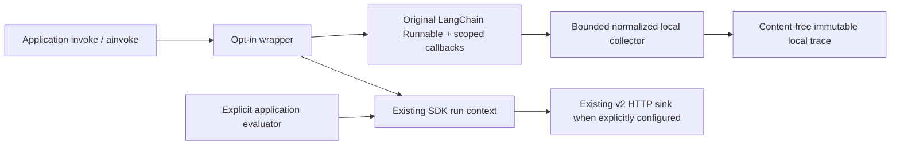

# P30 initial automatic instrumentation — design proposal

Status: independent architecture review GO; design findings AR-1/2/3 rechecked closed before implementation. This Session 3 instruction authorizes a focused
SDK vertical slice, not a release or the whole proposed P30 roadmap. D14 OPEN; Phase B NO-GO.

## Verified baseline and existing capabilities

SDK origin/main `b65374d0b2aaed2d06c563f738ca840e840956b9` is the published v1.3.0 merge. Platform
origin/main `805b9c718f370aea784143359a7d6e8b62ea81b2` includes merged PR62 and Session2 PR64.
Primary SDK/platform worktrees contain valuable dirty/untracked historical work; they remain untouched.
Worktree `gentlity-s3-sdk`, branch `session3/p30-automatic-instrumentation`, starts at current SDK main.

Existing SDK `AgentReliability.run`/`RunSession` own sync/async lifecycle, UUID run identity, parent linkage,
ContextVars, failure isolation and terminal health. `RunHandle` explicitly records outcomes/evaluator provenance;
UNKNOWN is distinct from PASS. Existing EventSink has four stable events, OTel RunContextBridge is optional,
and experimental HTTP sinks bind deployment identity and enforce indicator policy. No automatic framework,
step, tool or token capture exists. Do not duplicate the run engine, evaluator or HTTP delivery machinery.
No existing SDK component registry exists; platform P18a has 1000 steps, depth16 and512 components/version.

## Framework selection and verified sources

Select **LangChain Core Runnable callbacks**, initially pinned/tested `langchain-core==1.6.13` (PyPI metadata
inspected during this session; Python>=3.10). This provides synchronous and asynchronous public callback hooks,
per-invocation callback configuration and local fake Runnable/tool/chat-model implementations. LCEL Runnables
are the supported surface; LangGraph and agent-specific semantic boundaries are not claimed without tests.
This choice offers a compositional, vendor-neutral model/tool surface and no global patching. Adoption is a
qualitative ecosystem judgment, not an invented market-share measurement.

OpenAI Agents0.24.0 and LangGraph1.2.16 were considered (current PyPI metadata). Agents has public RunHooks,
but default tracing and sensitive-data collection need additional independent configuration and hooks have a
more provider-specific run model. LangGraph adds graph/node/checkpoint semantics and dependency burden beyond
this slice. No second adapter is implemented. No commercial provider calls are needed for tests.

Official references (retrieved2026-10-22):
- https://reference.langchain.com/python/langchain-core/callbacks/base/AsyncCallbackHandler
- https://github.com/langchain-ai/langchain/blob/master/libs/core/langchain_core/callbacks/base.py
- https://github.com/langchain-ai/langchain/blob/master/libs/core/langchain_core/callbacks/manager.py
- https://github.com/langchain-ai/langchain/blob/master/libs/core/langchain_core/callbacks/usage.py
- https://github.com/openai/openai-agents-python/blob/main/docs/tracing.md
- https://github.com/openai/openai-agents-python/blob/main/docs/agents.md
References describe current hooks; installed pinned source and real integration tests establish supported behavior.

## API and package boundaries

New **experimental** API: `agent_reliability.experimental.instrumentation.instrument(runnable, *, sdk,
agent_id, name, version, environment=None, framework="langchain", tool_names=(), model_id=None,
provider_id=None, limits=..., sample_rate=1.0)` returns an explicit wrapper with `invoke` and `ainvoke`,
`enable`, `disable`, `close`, bounded `traces` snapshots and bounded diagnostics counters.
No global registration, implicit import side effect, monkey patch, automatic environment discovery or provider change.
Repeated calls on the same wrapper are idempotent; wrapping an already instrumented wrapper is refused at setup.
Disable affects future invocations; in-flight invocations finish their original lifecycle. Close disables future
capture and clears retained traces; in-flight work is not cancelled and must not repopulate closed retention.
The wrapper keeps the original Runnable unchanged; disabled calls delegate the same input/config/kwargs directly.
Config preparation uses public ensure_config and copies caller/inherited callback lists/managers; preserve all
user callbacks, tags, metadata, run_name, parent context and explicit run_id. Remove only this adapter's inherited
handlers before attaching the new invocation handler, so nested wrappers own their child capture without
double-counting it in the ancestor trace. Use a generated framework UUID only if no explicit run_id exists;
validate existing IDs or degrade detailed capture without rewriting caller identity. The known framework root
is explicitly parented to our SDK run root, even when its framework parent belongs to an outer invocation.

`experimental/instrumentation/` owns immutable normalized events, bounded collector/controller and policy.
`adapters/langchain_instrumentation.py` owns all framework imports/hooks. Core neutral imports use stdlib only.
Optional extra `langchain` pins tested 1.6.13 initially; it does not install full LangChain or a provider SDK.
Missing dependency/unsupported version is a sanitized setup ImportError/ValueError before business invocation.
No stable SDK API or event union changes. This is an additive experimental API with no version/release bump.

## Lifecycle, context and causality

Wrapper enters/exits existing SDK session in the same calling sync/async context; never enter a ContextVar
session in one callback and reset its token in another task/thread. LangChain callbacks may execute on different
threads; a per-invocation collector with a short lock tracks validated framework UUIDs and parent UUIDs, not
callback-thread ContextVars. The handler sets run_inline=True for sync and async callbacks; it implements
on_chat_model_start explicitly, avoiding the framework default conversion of messages to prompt strings.
All callback entrypoints catch internal Exceptions before framework logging can format an exception. Normal Python task inheritance remains the existing SDK contract; manual external
threads require explicit context propagation. Nested wrappers produce SDK parent_run_id as before. Concurrent
calls have separate collectors. Admission counters are synchronized and bounded.

Normalized start/terminal events contain only SDK run_id, sequence, random/validated UUID span_id and
parent_span_id, closed kind(run/step/tool/model), approved optional component/provider/model identifiers,
UTC timestamps, monotonic duration and terminal state(completed/failed/cancelled/incomplete). Root run uses
the existing UUID; child callback parents refer to captured spans. Unknown parents are skipped with an
incomplete counter, never silently relabeled roots. Chain callbacks are framework steps, not semantic goals.
No content-bearing callback object, response, metadata or exception is retained in an event or collector.

Duplicate starts/terminals by UUID are idempotent. A completed callback with no known start is counted as
unmatched, not fabricated. At root exit, unclosed captured children get `incomplete` terminal markers (or
cancelled for propagated cancellation), explicitly synthetic closure, not claims of completion. Hard process
termination cannot guarantee a terminal event or flush; no recovery worker or persistent local spool is added.
Wrapper returns the original result object, preserves the original application exception object, and never
retries application execution. No generator/stream/batch/multiprocess support is claimed in this first API.

Logical operation: one wrapper invocation/SDK run. Callback span: one framework UUID. Framework retries may
create new callback spans; duplicate callbacks do not. `on_retry` is a bounded retry-signal count, not an
assertion of provider HTTP attempts or a second logical run. Model invocation count means observed model-start
callbacks; hidden provider retries cannot be inferred. No semantic retry/repetition diagnosis is implemented.

## Privacy, identifiers and evidence

Never inspect/copy/format prompts, model output text, tool input/output, retrieved data, arbitrary metadata,
headers, exception objects/messages/class names or callback tags. No logger sees framework payloads. Diagnostics
are closed-code saturated counters without raw IDs or exceptions. Safe built-in SDK diagnostics remain separate;
use a sanitized generic failure class at the root session boundary so customer-defined exception class names
cannot become export content, while re-raising the original application exception.

Explicit agent/name/version/environment and optional provider/model identifiers must be bounded ASCII logical
aliases (`[A-Za-z0-9._-]`,1–128), validated once at configuration. Grammar cannot prove absence of secrets;
the customer must provide non-sensitive logical aliases. Framework tool names are **not** emitted by default.
An explicitly configured finite allowlist emits only exact approved names; all others have component=None.
Model/provider identifiers are configured safe aliases, not read from serialized constructor or response metadata.
At most512 approved identifiers are accepted (no dynamic registry growth or hash of a sensitive name).
Existing deployment binding belongs to the configured HTTP sink; no tenant/deployment identity is inferred.
Existing SDK/P18 counts are separate scopes: this local cap is not a platform-version quota guarantee.

Provider token usage is extracted only from documented numeric usage fields: one ChatGeneration's
`AIMessage.usage_metadata`, or `LLMResult.llm_output.token_usage`. total/input/output are individually validated
nonnegative bounded integers (bool refused). Missing/invalid/ambiguous total means `unknown` with null counts;
never infer totals or estimate tokens from text. Multiple candidate usages are not summed silently. No pricing,
monetary cost or content opt-in exists. Model span latency is callback elapsed time, not pure provider-network time.

The stable EventSink union and HTTP schema v2 remain unchanged. SDK root lifecycle and separately explicit
evaluations may use the **existing** exporter and indicator policy. Detailed P30 step/tool/model/token events
stay in bounded local trace snapshots; there is no new sink or unrestricted HTTP path. Mapping local details to
P18/P20 endpoints is deferred to a separately reviewed language-neutral producer contract, not improvised here.
A successful run/tool is execution evidence only: no automatic EvaluationRecorded/PASS, no fabricated evaluator
provenance. Reliability has no measured outcome until the caller explicitly evaluates/records an indicator.
The adapter never enables/disables LangSmith or other customer-installed third-party tracing; customers
must independently configure those content/export policies. Our no-content guarantee is scoped to our new
capture path, not arbitrary SDK sinks or framework integrations. No platform or Session2 behavior changes; their missing/UNKNOWN rules remain in force.

## Failure isolation and resource budgets

Configuration misuse fails at setup, before customer work. Runtime collector/callback Exceptions are suppressed
into bounded diagnostics; preserve cancellation/KeyboardInterrupt/SystemExit from application execution.
No arbitrary user event/diagnostic callback runs in our callback path. It only validates bounded IDs/numbers and
updates in-memory state under a lock; it does not do I/O or export details. Existing SDK sinks are trusted and
retain their documented synchronous/queue behavior; an arbitrary blocking custom sink is not made safe here.
No hard wall-clock bound can be promised for Python execution/lock scheduling or the pre-existing SDK sink.

Provisional measurable budgets: max1000 child spans (hard1000), depth16(hard16),2 events reserved per accepted
span plus root2, max32 admitted concurrent runs(hard128),8 retained traces(hard32),512 configured aliases.
Saturating counters cap at2^63-1. Buffer drop-new-start with visible truncation keeps already accepted terminal
slots reserved; no dynamic allocation per dropped callback beyond fixed counters. Bounded active state is
released at invocation exit; retention drops oldest. Admission failure passes through uninstrumented with a
counter, without altering result. Trace sampling is deterministic configurable probability at invocation admission
(default1), independent of success/outcomes; unsampled calls run unchanged. Partial captures are marked incomplete. Before SDK session exit, callback failures, truncation, orphan events
and unfinished spans monotonically mark existing RunHandle health PARTIAL_EVIDENCE on the owning thread.
Expected absent provider token usage is an explicit unknown fact, not automatically an evaluation failure.
Memory is bounded by configured active/retained traces times bounded event/span objects; measure peak allocation,
not claim a fixed platform-independent byte total. Timings/overhead have no production-SLO claim.

## Verification and review gates

Architecture review before substantial code. Author implements only after actionable architecture findings are
resolved. Fresh implementation/adversarial reviewers and an independent validator execute their own relevant tests;
review reports are reviewer-owned. No unresolved BLOCKER/HIGH for owner review; actionable MEDIUM fixed or explicitly
gated. No platform/schema/breaking API change is proposed; if one becomes necessary, stop for owner approval.

Tests: real pinned local Runnables, tools, fake chat models (no remote calls); sync/async/nesting/thread callbacks,
concurrent tasks, real framework retries, duplicates/orphans/partial events, cancellation/exception identity,
enable/disable/reinitialize, bad/missing dependency/version, token known/unknown/ambiguous, input/output sentinel
privacy, bounded identifier/cardinality/memory and callback flood, same SDK v1.3 behaviors and HTTP regression suite.
Build wheel/sdist; clean no-extra and framework-extra installations; Python 3.11/3.12/3.13 suites, Ruff/mypy,
existing contract vectors/Node reference, CI. Benchmark uninstrumented/instrumented trivial calls, high-frequency
tools, concurrent async runs and limit-exceeding traces; record raw absolute/relative timings, environment and
allocation peaks. No paid LLM, network provider, AWS or production benchmark.

Open scope limitations are deliberate: no automatic semantic evaluation, raw-content capture, pricing, remote
P18/P20 producer, streams/batches, graph-specific semantics, additional frameworks or production-readiness claim.
